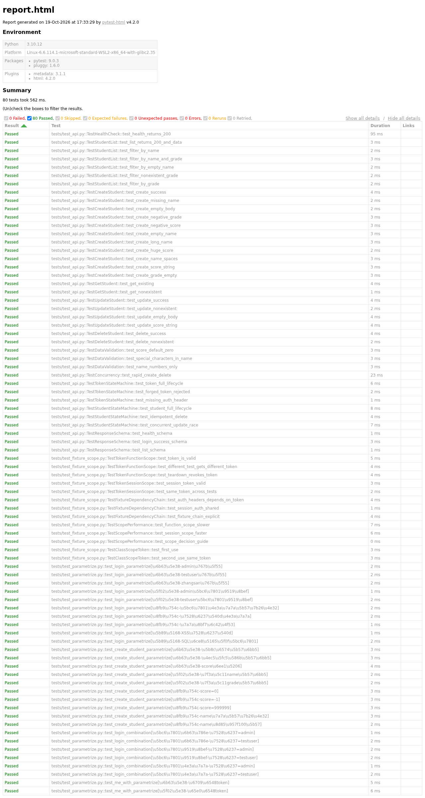

# 简易用户管理 API 测试平台


> 测试工程师实战项目 | 2026.06 — 2026.08

## 项目简介

独立完成的全流程 API 测试项目。核心接口包括**登录、用户注册、用户查询/修改、分页列表查询、用户状态启停** 5 大模块。

## 技术栈

| 层次 | 技术 | 说明 |
|------|------|------|
| 被测系统 | Python Flask 3.x | 自建 REST API 服务 |
| 接口自动化 | pytest 9.0 + requests | 87 条自动化测试用例 |
| Web 自动化 | Selenium + pytest | 后台管理 UI 测试 |
| 性能测试 | JMeter 5.6 | CSV 参数化压测 + 混合场景 |
| 测试报告 | pytest-html + Allure | 可视化报告 |
| CI/CD | GitHub Actions | push 自动跑测试 |
| 环境 | WSL2 + Linux + Nginx | 测试环境部署 |

## 项目结构

```
testing-portfolio/
├── api/                    # Flask API 被测系统
│   └── app.py
├── tests/                  # 自动化测试
│   ├── conftest.py         # 全局 fixture + 测试数据
│   ├── test_api.py         # 接口自动化用例
│   └── test_login_pytest.py # Web UI 用例
├── data/                   # 测试数据（第5周接入 Excel 数据驱动）
├── docs/                   # 测试设计与部署文档
│   ├── testcase-table.md          # 用例总表
│   ├── equivalent-class-analysis.md  # 等价类分析
│   ├── boundary-value-analysis.md    # 边界值分析
│   ├── orthogonal-analysis.md        # 正交分析
│   ├── deployment-guide.md           # Nginx 部署指南
│   └── nginx-flask*.conf             # 反代配置（基础 + 增强）
├── jmeter_script/          # JMeter 脚本 + 压测报告
├── reports/                # 测试报告
├── logs/                   # 运行日志
├── learning/               # 学习计划/进度/笔记（过程文件）
├── .github/workflows/      # CI 配置
└── README.md
```

## 快速开始

### 启动 API 服务
```bash
./run.sh start
```

### 运行测试
```bash
./run.sh test         # 冒烟测试
./run.sh test-all     # 全部测试 + HTML 报告
pytest -m smoke       # 只跑冒烟用例
pytest -m "not slow"  # 跳过慢用例
```

### 生成测试报告
```bash
pytest --html=reports/report.html                    # HTML 报告
pytest --alluredir=allure-results && allure serve .   # Allure 报告
```

### 停止服务
```bash
./run.sh stop
```

## 测试覆盖（87 条，pytest --collect-only 实测）

| 分类（pytest marker） | 用例数 | 说明 |
|------|------|------|
| CRUD 增删改查 | 19 | 登录/注册/查询/修改/状态启停 |
| 异常测试 | 12 | 无效输入、token 异常 |
| 边界值测试 | 9 | 刚好等于/小于/大于 |
| 冒烟测试 | 7 | 核心功能快速验证 |
| Web UI（Selenium） | 7 | 后台管理界面 |
| 慢用例/并发 | 2 | 大数据量场景 |
| JMeter 并发 | 100 用户 | CSV 参数化压测 |

> 用例间存在 marker 重叠（如某 CRUD 用例同时标记 smoke），合计 87 条以 pytest 收集为准。

## 测试报告

最新全量测试结果：**80 passed, 7 deselected**（7 个为需浏览器的 Selenium 用例，未计入本次运行）



## 学习路线

```
第1周 ✅ 读懂代码 → 第2周 ✅ 测试设计 → 第3周 ✅ pytest深入 → 第4周 🔴 Linux实操（57%）
→ 第5-6周 API深度 → 第7-8周 JMeter深入 → 第9-10周 CI/CD → 第11-12周 求职
```

详见 [`learning/LEARNING-PLAN.md`](./learning/LEARNING-PLAN.md) 和 [`learning/PROGRESS.md`](./learning/PROGRESS.md)

## 关键指标

| 指标 | 当前 | 目标 |
|------|------|------|
| API 测试用例 | 87 | 50+ ✅ 已超额 |
| GitHub Commits | 60 | 60+ ✅ 达成 |
| 学习笔记 | 25 | 40+ |
| 连续打卡 | 18 天 | 84 天 |

---

> 📌 独立完成的测试工程师实战项目，覆盖接口测试、Web 自动化、性能测试与 CI/CD 全链路（开发过程使用 AI 工具辅助提效）。
